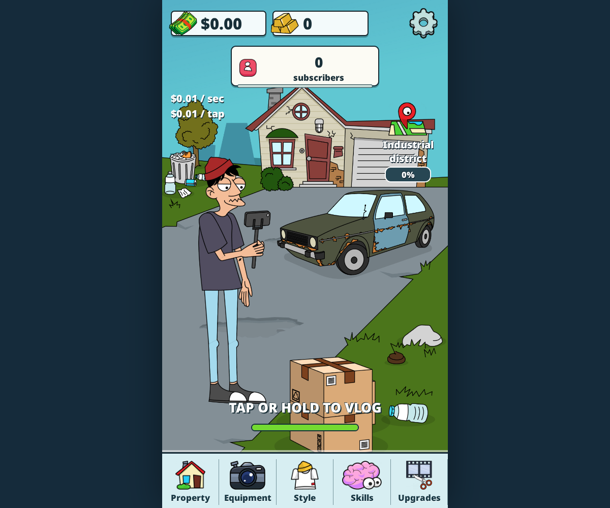
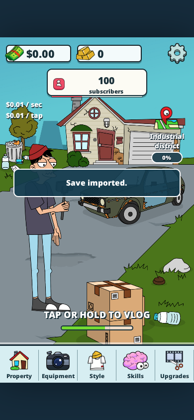
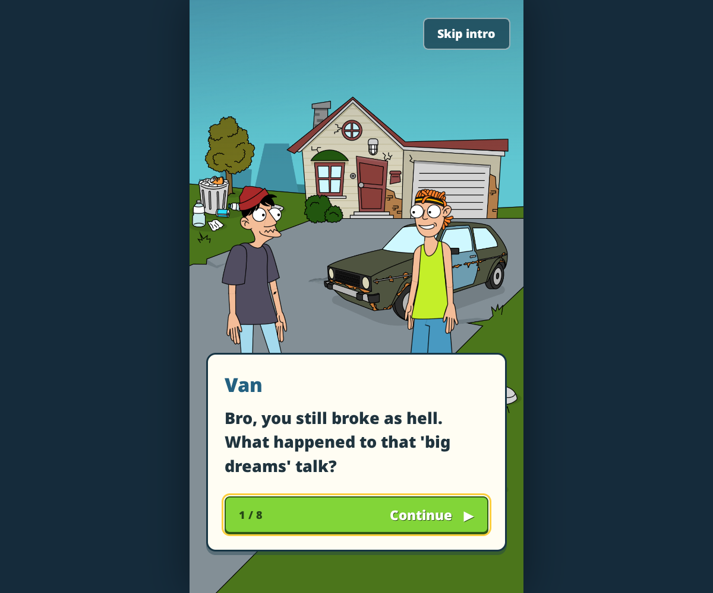
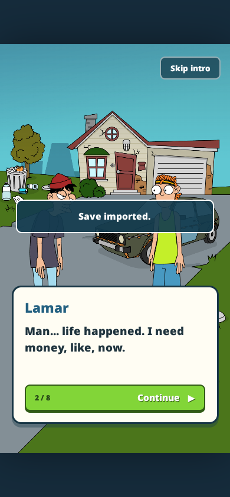
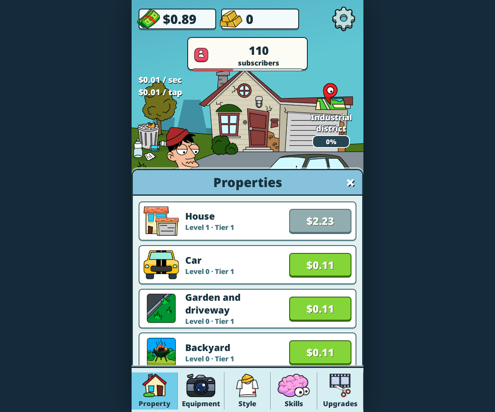
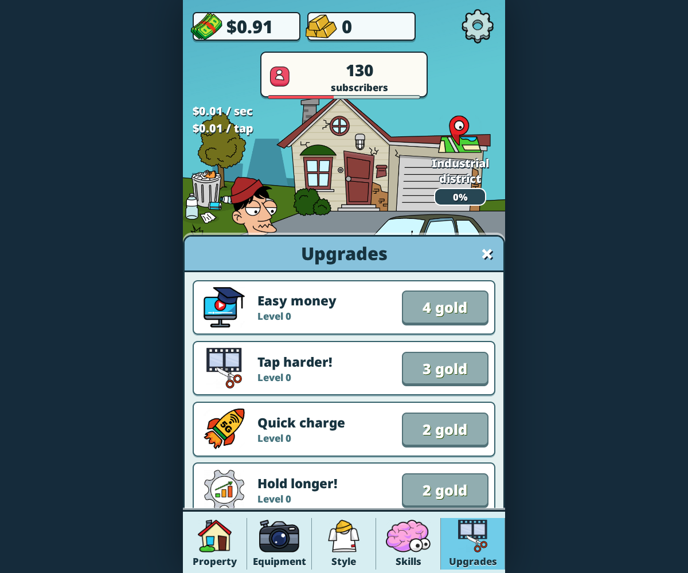
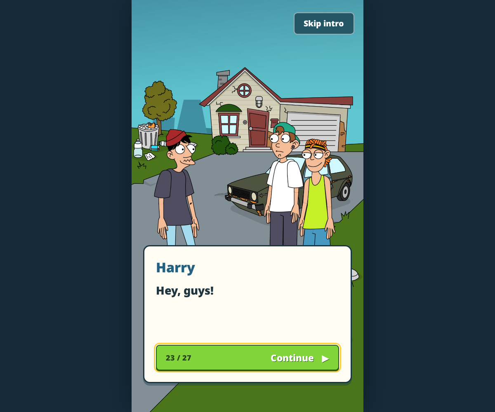
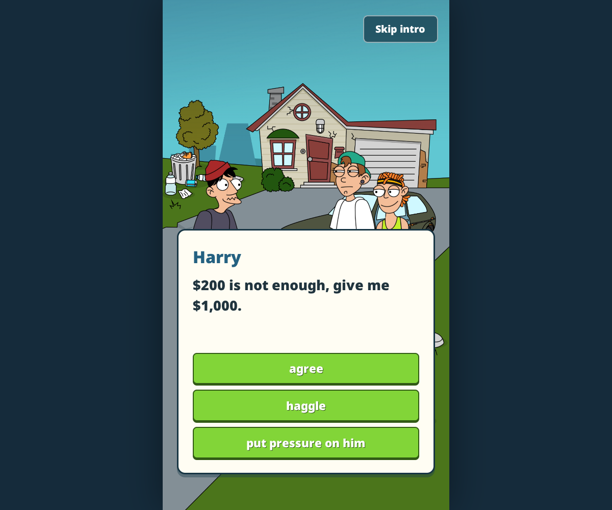

# Validation record

Executed 2026-10-20 on Linux x86-64, Node 24.19.0.

| Check | Result |
| --- | --- |
| APK ZIP and every native ELF inspection | Completed; recorded in `inspection.json` |
| Resource conversion | 1,060 virtual files; six reported singular-matrix sprite failures |
| Complete Spine atlas/page/attachment checks | Passed; all 112 mapping entries resolve to real slots/attachments |
| Pack size and SHA-256 integrity | Passed; each pack at most 4 MiB |
| Every virtual file span / decompression | Passed |
| All eight scene texture references | Passed |
| Simulation at 30, 60 and 144 display FPS | Identical tick count, money, subscribers and battery |
| Income boundaries / purchase balance | Passed for reconstructed formulas; not native parity |
| Offline double-claim / cap | Passed |
| Save input validation | Passed |
| Native item income / costs / discounts | Exact agreement with 601 / 600 / 3,600 ARM64 reference results |
| All 16 upgrade price/value ranges | Exact agreement with original ARM64 function execution; see `NATIVE-RULES.md` |
| Original introductions | Full 27-frame intro, choice route with saved decisions/reload, short replay/skip checked in production browser |
| Branch coverage | All 12 choice-intro routes reach the end and retain three decisions in the unit suite |
| Unit/resource suite | **19/19 passed** |
| Vite production build | **Passed** |
| Chrome Headless Shell 155.0.8059.84 launch | **Passed**, WebGL via SwiftShader |
| Original character rig | Loaded; **169 animations** |
| Hold to earn and purchase House level 1 | Passed through browser pointer input |
| Save reload | Purchased level retained |
| Save export, valid import, invalid import rejection | Passed |
| Browser page errors | None during successful smoke test |
| Desktop / phone-size visual inspection | Completed; screenshots below |
| Production subdirectory hosting | Checked using `tests/browser.mjs --build` under `/idle-vlogger/` |
| Native Android execution/comparison | **Not performed** |
| Complete progression/story playthrough | **Not performed** |
| Real touch/gamepad hardware | **Not performed** |

The first browser downloads/launches failed: an incomplete full-Chrome package, a sandbox Unix-socket restriction on full Chrome, and a Chrome 131 headless-shell crash. The successful test used the current standalone headless shell, downloaded intact and launched without changing the host permission policy. These failures are not treated as successful runs.

The build emits a warning about its approximately 626 kB JavaScript bundle (approximately 187 kB gzip). This is not a build failure. It includes PixiJS and the Spine 3.8 runtime.

Tests validate implementation consistency and basic browser operation. They do not establish original-game balance or complete visual/behavioral parity. See `PARITY.md`.

## Milestones 2 and 3

## Milestone 4

